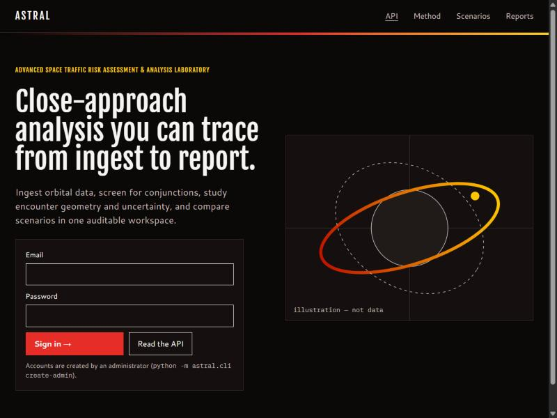
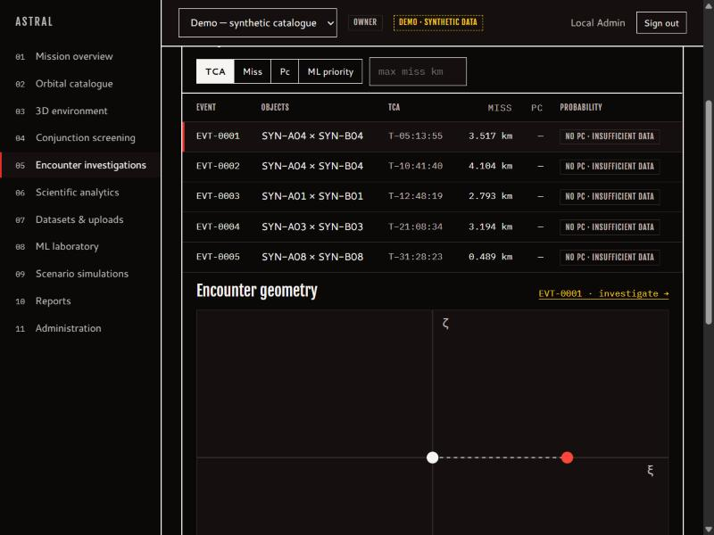
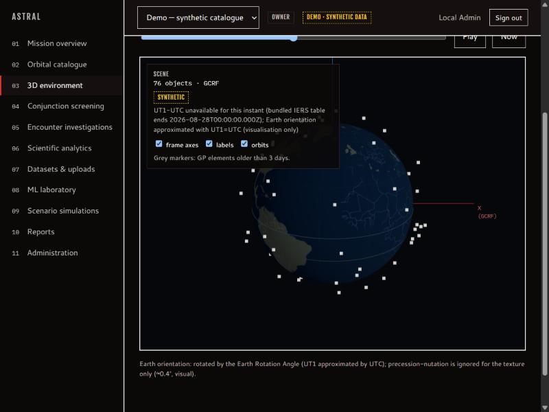

# ASTRAL

**Advanced Space Traffic Risk Assessment & Analysis Laboratory** — a research and evaluation platform for orbital-data ingestion, conjunction screening, encounter-geometry analysis, covariance-based probability of collision, hypothetical manoeuvre comparison and reproducible reporting.

> **Readiness statement.** ASTRAL is research and evaluation software. It is **not** qualified for operational conjunction assessment or spacecraft-safety decisions. It has no flight heritage, certification or agency acceptance. Passing its automated tests does not change that. See [VALIDATION_REPORT.md](VALIDATION_REPORT.md) and [ROADMAP.md](ROADMAP.md).



## What it does

| Capability | Status |
|---|---|
| Ingest TLE, OMM (KVN/XML/JSON/CSV), OEM (KVN), CDM (KVN), ASTRAL CSV/JSON state vectors; validation, duplicate/conflict/staleness detection, immutable versioned snapshots with SHA-256 | Implemented, tested |
| SGP4 propagation (python-sgp4, Vallado verification set reproduced to < 1 mm) | Implemented, reference-tested |
| Operator ephemeris interpolation (cubic Hermite, no extrapolation, gap-aware) | Implemented, reference-tested |
| Frame/time handling: TEME, GCRF, EME2000, ITRF; UTC/TAI/TT/GPS/TDB | Implemented, reference-tested |
| Catalogue screening with a provably conservative proximity bound, k-d tree, Brent TCA refinement | Implemented, brute-force-tested |
| 2D probability of collision (Foster/Alfano erf-quadrature) **only** with both covariances and an explicit hard-body radius; Monte Carlo cross-check | Implemented, tested against closed forms |
| `INSUFFICIENT_DATA_FOR_PC` when inputs are missing (e.g. all TLE-based screening) | Enforced and tested |
| Experimental ML prioritisation (synthetic labelled data, rule baseline, PR/calibration metrics, registry, OOD flags) | Implemented; **experimental** |
| Hypothetical impulsive-manoeuvre comparison (two-body + J2, simulation only) | Implemented; research-grade model |
| 3D orbital environment, encounter investigation, scientific charts with CSV export | Implemented |
| Reports: PDF, CSV, JSON; CCSDS OEM and CDM export | Implemented |
| Auth (Argon2id, sessions + CSRF, API tokens), project RBAC, audit log, rate limits, quotas | Implemented, security-tested |
| PostgreSQL + external worker via Docker Compose; SQLite local profile | Implemented, smoke-tested |

## Quick start (local development profile)

Requirements: Python 3.11, Node.js 20+ (22 tested). No GPU, no cloud services, no internet access needed at run time.

```bash
cd backend
python -m venv .venv
.venv/Scripts/pip install -r requirements.lock.txt   # Linux/macOS: .venv/bin/pip
.venv/Scripts/python -m astral.cli migrate
ASTRAL_ADMIN_PASSWORD='choose-a-12+-char-password' .venv/Scripts/python -m astral.cli create-admin --email you@example.org
.venv/Scripts/python -m astral.cli seed-demo --email you@example.org      # optional SYNTHETIC demo project
.venv/Scripts/python -m astral.cli train-ml --activate                    # optional experimental model
.venv/Scripts/python -m uvicorn astral.main:app --port 8000
```

```bash
cd frontend
npm ci
npm run dev        # http://localhost:5173 (proxies /api to :8000)
```

API documentation (OpenAPI): <http://localhost:8000/docs>. Production deployment: [DEPLOYMENT.md](DEPLOYMENT.md).

## Tests

```bash
cd backend && .venv/Scripts/python -m pytest -q          # 102 tests: reference, unit, integration, security, ML
cd frontend && npm test && npm run typecheck && npm run lint
```

## Documentation

[ARCHITECTURE](ARCHITECTURE.md) · [SCIENTIFIC_METHODS](SCIENTIFIC_METHODS.md) (includes the assumptions register) · [DATA_FORMATS](DATA_FORMATS.md) · [API](API.md) · [USER_GUIDE](USER_GUIDE.md) · [SECURITY](SECURITY.md) · [DEPLOYMENT](DEPLOYMENT.md) · [OPERATIONS](OPERATIONS.md) · [VALIDATION_REPORT](VALIDATION_REPORT.md) · [ML_CARD](ML_CARD.md) · [MODEL_AND_DATA_LIMITATIONS](MODEL_AND_DATA_LIMITATIONS.md) · [LICENSES](LICENSES.md) · [ROADMAP](ROADMAP.md) · [CHANGELOG](CHANGELOG.md)

## Design

The interface implements the "ASTRAL Pairings" design exploration (`docs/design/`): pairing **D "Ignition"** (default — black ground, red accent, yellow secondary, Fjalla One / Cantarell / IBM Plex Mono) and **E "Kyoto"**, each with dark/light modes, density and accent-hue controls under *Administration → Appearance*. Deliberate deviations from the mock-up, made for scientific honesty: risk badges appear only for computed probabilities and always carry text; the mock-up's "Recommended" manoeuvre label became "Simulated"; covariance ellipses are drawn only when a covariance exists.



